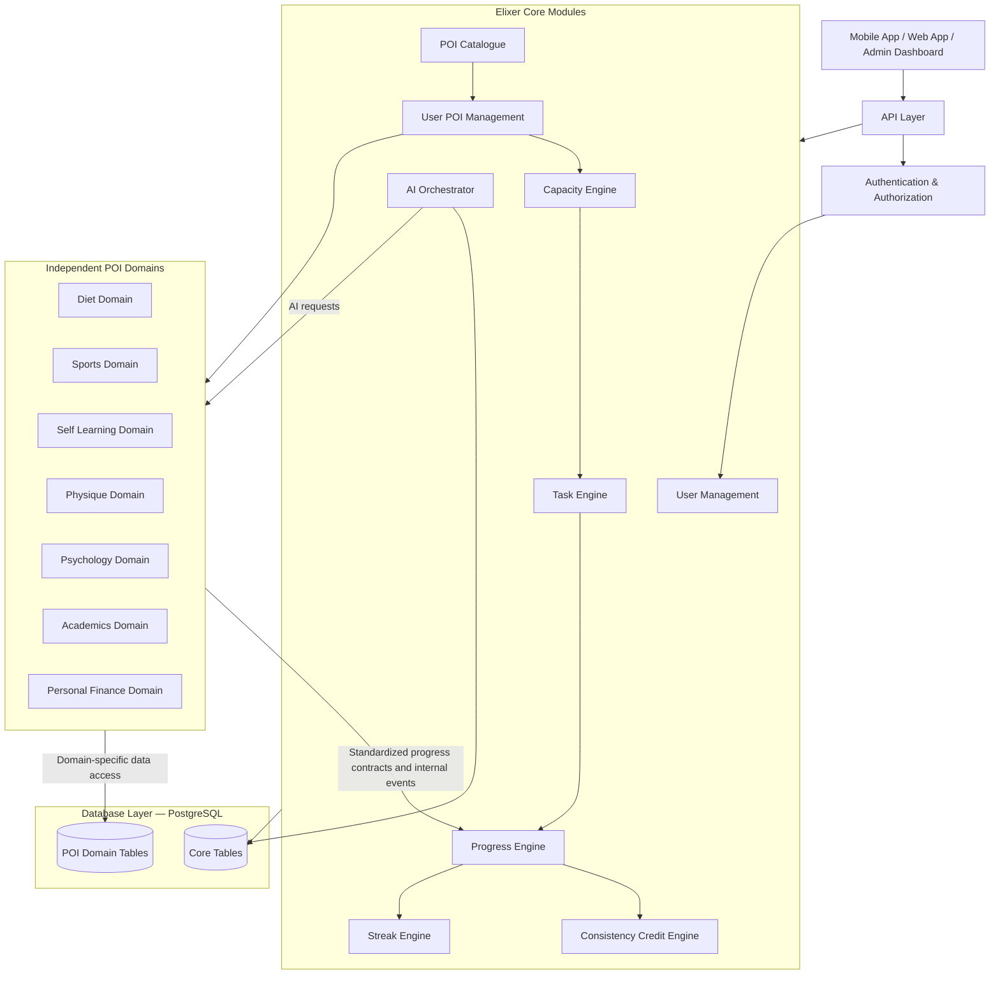

# Elixer™ — Modular Backend Architecture

## 1. Overview

Elixer uses a modular monolith architecture.

The backend runs as one application but is divided into independent modules with clearly defined responsibilities.

Elixer Core manages shared platform functionality, while individual POI domains manage their specialized functionality.

## 2. Architecture Diagram



## 3. Module Responsibilities

### Elixer Core

- User Management: manages user-related platform data.
- POI Catalogue: manages the official POI catalogue. Only administrators can modify it.
- User POI Management: manages POIs selected by individual users.
- Capacity Engine: estimates realistic user capacity.
- Task Engine: manages task creation, scheduling and completion.
- Progress Engine: aggregates progress from Core and POI domains.
- Consistency Credit Engine: validates and manages CC rewards.
- Streak Engine: calculates consistency streaks.
- AI Orchestrator: coordinates AI-powered functionality.

### POI Domains

Each POI domain owns its specialized business logic and data.

For example:

- Diet: meals and nutrition tracking.
- Sports: sports practice and performance.
- Personal Finance: expenses, budgets and savings.
- Self Learning: independent learning and skill development.

### Database Layer

Core modules own Core tables.

Each POI domain owns its domain-specific tables.

All modules initially use one PostgreSQL database, with clear ownership boundaries.

## 4. Architectural Rules

1. Each module owns its internal business logic.
2. Modules communicate through defined interfaces and contracts.
3. POI domains do not directly access another POI domain's internal data.
4. Core receives standardized progress information from POI domains.
5. Only administrators can modify official POI definitions.
6. CC and streak calculations are validated by backend logic.
7. The architecture remains a modular monolith during the initial development phase.
```
