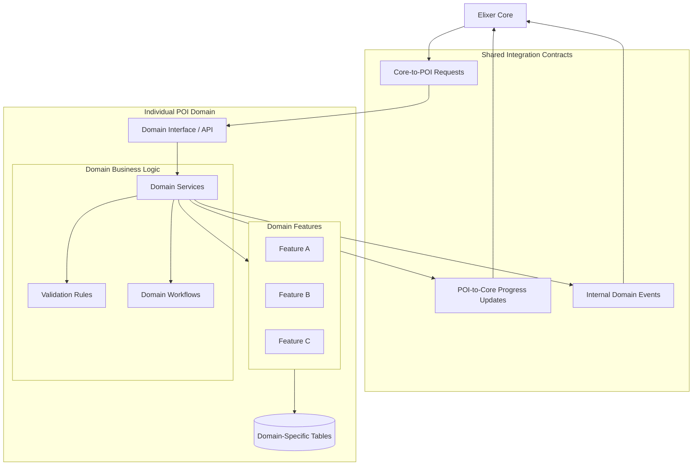

# Elixer™ — POI Domain Architecture

## 1. Overview

Each Point of Improvement (POI) is an independent functional domain within Elixer.

A POI owns its specialized functionality, business logic, validation rules and domain-specific data.

POI domains communicate with Elixer Core through standardized contracts and internal events.

## 2. Architecture Diagram

## 3. Example: Diet POI

The Diet domain may contain:

- Meal logging.
- Food and ingredient records.
- Nutritional information.
- Calorie and macronutrient tracking.
- Dietary goal tracking.
- Meal history and reports.

Its database may contain:

- diet_meals
- diet_food_items
- diet_ingredients
- diet_nutrition_records
- diet_goals

The Diet domain validates and processes its own information.

It then provides standardized progress information to Elixer Core.

## 4. Example: Sports POI

The Sports domain may contain:

- Sports selection.
- Practice session logging.
- Training schedules.
- Performance measurements.
- Skill development.
- Practice history.

Its database may contain:

- sports_activities
- sports_sessions
- sports_performance
- sports_goals

The Sports domain independently manages these records.

## 5. Integration with Elixer Core

Elixer Core should not need to understand every internal detail of a POI.

Instead, each POI provides standardized information such as:

- Current progress.
- Goal progress.
- Completed activities.
- Relevant performance measurements.
- Recommended next actions, where applicable.

Core can use this information for:

- Overall progress visualization.
- Current Me versus Ideal Me.
- Task planning.
- Capacity management.
- Progress summaries.

## 6. Important Architectural Rules

1. Each POI owns its business logic.
2. Each POI owns its domain-specific data.
3. POIs must not directly modify another POI's internal records.
4. POIs communicate with Core through defined contracts.
5. Core consumes standardized progress information.
6. POIs remain independent functional domains, not merely habit categories.
7. Initially, POIs run inside the same modular backend application.
8. Separate deployment is not required for each POI.
