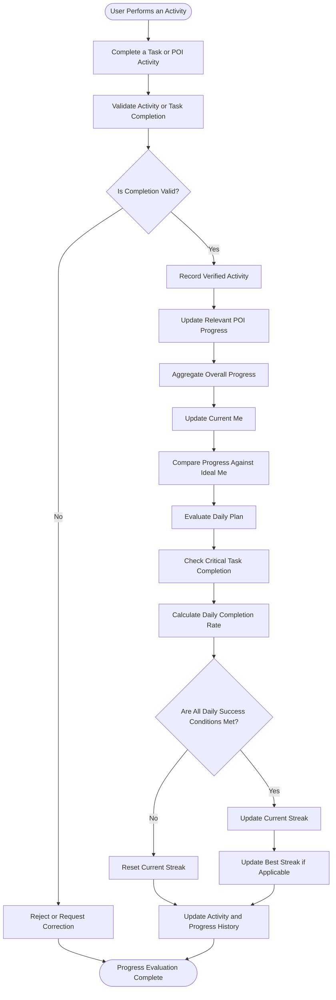

# Elixer™ — Progress and Streak Workflow

## 1. Overview

Elixer tracks progress across individual POIs and combines relevant progress information into an overall view of the user's personal evolution.

The Progress Engine and Streak Engine have separate responsibilities.

The Progress Engine tracks achievements and goal progress.

The Streak Engine evaluates whether the user has satisfied the defined daily success conditions.

## 2. Progress and Streak Diagram

## 3. Progress Engine Responsibilities

### POI-Level Progress

Each POI reports relevant progress information based on its own domain.

Examples:

- Diet: nutrition and meal consistency.
- Sports: practice sessions and performance.
- Self Learning: learning activities and skill development.
- Physique: physical measurements and fitness indicators.
- Psychology: self-reflection and wellbeing activities.
- Academics: coursework and examination preparation.
- Personal Finance: budgets, savings and financial goals.

### Overall Progress

The Progress Engine combines standardized POI progress information.

It supports:

- Current Me visualization.
- Ideal Me comparison.
- Individual POI progress.
- Overall progress summaries.
- Historical progress tracking.

The overall progress model should avoid treating unrelated measurements as directly interchangeable.

## 4. Streak Engine Responsibilities

The Streak Engine evaluates daily success according to predefined rules.

It considers:

1. Daily task completion rate.
2. Completion of designated critical tasks.
3. The user's applicable daily success policy.
4. Approved exceptions, such as eligible recovery or emergency arrangements.

A completed task alone does not guarantee a successful day.

### Streak Metrics

Elixer tracks:

- Current streak.
- Best streak.
- Successful days.
- Active achievement days.

## 5. Consistency Credit Integration

The CC Engine and Streak Engine are separate systems.

The CC Engine:
- Validates reward eligibility.
- Calculates eligible rewards.
- Prevents duplicate rewards.
- Enforces daily reward limits.

The Streak Engine:
- Evaluates daily success.
- Updates streak records.
- Maintains streak history.

AI cannot directly modify CC balances or streak records.

## 6. Important Architectural Rules

1. POI domains own their specialized progress measurements.
2. The Progress Engine aggregates standardized progress information.
3. Current Me represents measured or recorded current progress.
4. Ideal Me represents user-defined targets.
5. Progress updates and daily streak evaluations are separate operations.
6. Daily success depends on the complete success policy.
7. CC rewards do not automatically determine streak success.
8. Streak and CC calculations are validated by deterministic backend logic.
9. Progress history must be preserved for historical comparisons.
