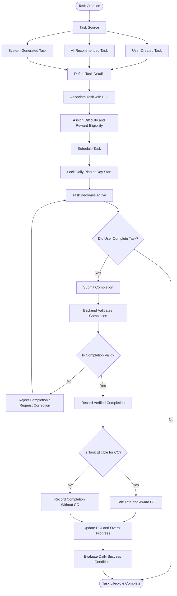

# Elixer™ — Task Lifecycle

## 1. Overview

The Task Engine manages the lifecycle of tasks created for a user's selected POIs.

Tasks move through defined stages, from creation and scheduling to completion, validation and progress recording.

The backend validates task completion and determines whether rewards are eligible.

## 2. Task Lifecycle Diagram

## 3. Task Lifecycle Stages

### Stage 1 — Task Creation

Tasks may originate from:

- User-created tasks.
- AI recommendations.
- System-generated tasks.

All tasks must have a defined purpose and measurable completion criteria.

### Stage 2 — Task Configuration

Each task can contain:

- Task title and description.
- Associated POI.
- Difficulty level.
- Expected duration.
- Scheduled date and time.
- Completion criteria.
- CC reward eligibility.

### Stage 3 — Scheduling and Locking

The Task Engine schedules tasks according to:

- User availability.
- POI priorities.
- Capacity Engine recommendations.
- Recovery requirements.

The daily plan is locked at the agreed day-start cutoff.

After locking, users cannot retroactively change task difficulty or reward eligibility to manipulate CC rewards.

### Stage 4 — Completion and Validation

When a user completes a task:

1. The user submits completion.
2. The backend validates the completion criteria.
3. Invalid submissions are rejected or returned for correction.
4. Valid completions are recorded.

### Stage 5 — CC Rewards

The backend determines whether the completed task qualifies for CC.

Important rules:

- CC is awarded only once per eligible task.
- Reward difficulty is locked before task execution.
- Duplicate rewards must be prevented.
- Daily reward limits must be enforced.
- AI cannot directly award or modify CC.

### Stage 6 — Progress and Streak Updates

After completion:

- POI progress is updated.
- Overall progress is recalculated.
- Daily success conditions are evaluated.
- Streak records are updated according to the Streak Engine's rules.

## 4. Important Architectural Rules

1. Task creation and task completion are separate operations.
2. Completion must be validated by the backend.
3. CC rewards are calculated by deterministic backend logic.
4. AI cannot directly modify CC or streak records.
5. The same task cannot generate duplicate rewards.
6. Daily plans follow defined locking rules.
7. Task completion and daily success are not necessarily the same thing.
8. Streak evaluation must consider the complete daily success policy, not just one completed task.
