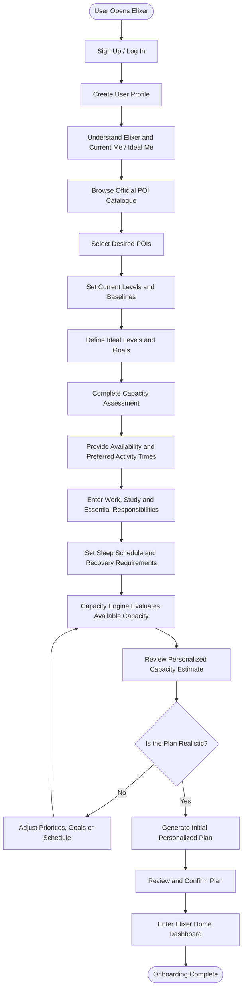

# Elixer™ — User Onboarding Flow

## 1. Overview

The onboarding process collects the information required to understand a user's current situation, goals, available capacity and selected Points of Improvement (POIs).

The system uses this information to prepare a realistic personalized plan.

## 2. Onboarding Flow Diagram

## 3. Onboarding Stages

### Stage 1 — Account and Profile

- User creates an account or logs in.
- User provides basic profile information.
- User learns about Elixer's Current Me and Ideal Me concept.

### Stage 2 — POI Selection

- User browses the official POI catalogue.
- User selects the POIs they want to work on.
- User establishes their current baseline for each selected POI.
- User defines their desired goals and target levels.

Important: Users can select official POIs but cannot create or modify official POI definitions.

### Stage 3 — Capacity Assessment

The system collects information about:

- Work and study schedules.
- Essential responsibilities.
- Sleep requirements and schedule.
- Available flexible time.
- Preferred activity times.
- Energy patterns.
- Realistic task capacity.

Sleep and recovery time must be protected, not treated as spare productivity time.

### Stage 4 — Capacity Evaluation

The Capacity Engine:

- Estimates available time.
- Accounts for essential responsibilities.
- Protects recovery time.
- Considers user priorities.
- Reserves scheduling buffers.
- Identifies unrealistic commitments.

If the plan is unrealistic, the user can adjust their priorities, goals or schedule.

### Stage 5 — Personalized Plan

Once the capacity assessment is accepted:

- Elixer generates an initial personalized plan.
- The user reviews the proposed plan.
- The user confirms the plan.
- The user enters the main dashboard.

## 4. Important Rules

1. Users choose from the official POI catalogue.
2. Users cannot create official POIs.
3. Goals should reflect individual circumstances.
4. Capacity estimates must account for recovery.
5. The system must avoid overloading users.
6. Users should be able to revise their personal goals and availability later.
7. AI recommendations should remain optional and subject to user approval.
