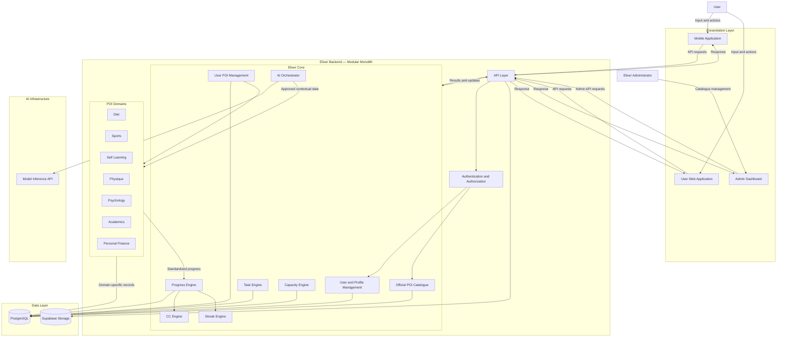

# Elixer™ — Data Flow Diagram

## 1. Overview

This diagram illustrates how data moves through Elixer's major components.

It covers user input, authentication, Core processing, POI domain operations, database storage, progress aggregation and AI-assisted recommendations.

## 2. Data Flow Diagram

## 3. Main Data Flow Stages

### Stage 1 — User Input

Users interact with Elixer through the mobile or web application.

Examples:

- Selecting POIs.
- Creating tasks.
- Logging activities.
- Updating goals.
- Recording progress.

Administrators use the Admin Dashboard to manage the official POI catalogue.

### Stage 2 — API and Authentication

The API Layer receives requests.

Authentication and authorization determine:

- Who is making the request.
- Whether the user is authenticated.
- Whether the requested action is permitted.
- Whether the user can access the requested data.

### Stage 3 — Core Processing

Elixer Core processes shared functionality.

Examples:

- User profile management.
- POI selection.
- Capacity assessment.
- Task scheduling.
- CC validation.
- Streak evaluation.
- Overall progress aggregation.

### Stage 4 — POI Domain Processing

The selected POI domain processes specialized information.

For example, a Diet activity is processed by the Diet domain rather than by the Sports domain.

Each domain owns its specialized data.

### Stage 5 — Data Storage

PostgreSQL stores structured relational data.

Supabase Storage stores appropriate files and media.

Sensitive data must have appropriate access controls and retention policies.

### Stage 6 — AI Processing

The AI Orchestrator coordinates approved AI requests.

The inference service returns recommendations or analysis to the backend.

AI must not directly modify authoritative CC, streak or financial records.

### Stage 7 — Results

The backend returns authorized results to the relevant application.

Users can see updated tasks, POI progress, overall progress and recommendations.

## 4. Important Data Flow Rules

1. Applications communicate with the backend through authorized APIs.
2. The backend validates requests before processing them.
3. Each POI domain owns its specialized data.
4. Core receives standardized progress information.
5. Sensitive data must only be shared with AI services when permitted.
6. Database writes must follow module ownership rules.
7. The backend controls authoritative progress, CC and streak records.
8. Users must only access data they are authorized to view.
