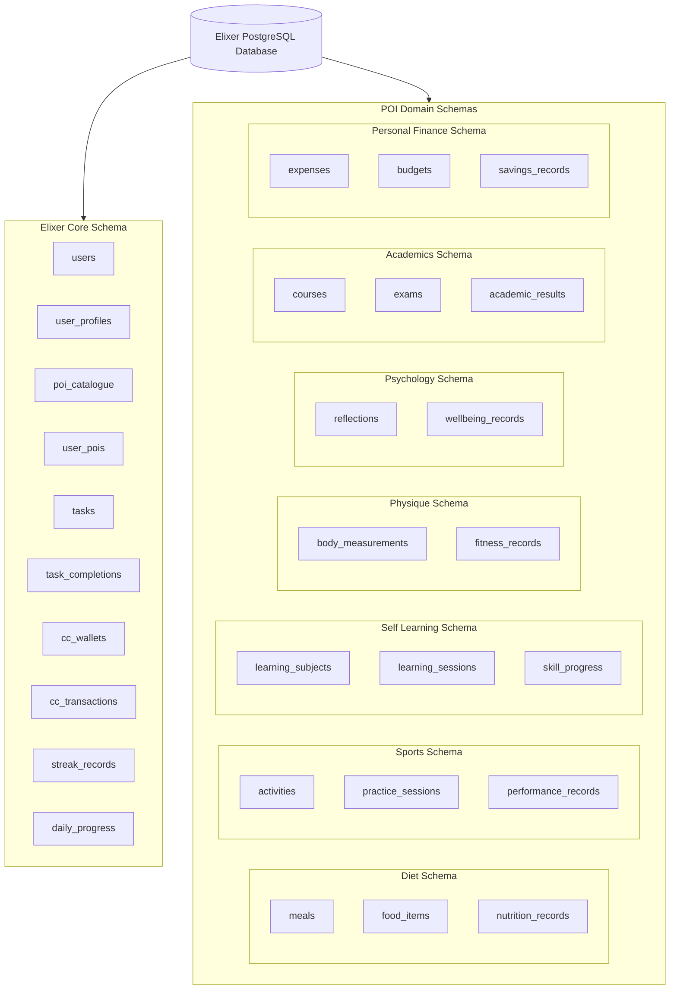

# Elixer™ — Database Schema Organization

## 1. Overview

Elixer uses PostgreSQL as its central relational database.

The database is logically organized into Core tables and independent POI domain tables.

Each module owns its data and exposes information to other modules through defined interfaces.

## 2. Database Organization Diagram



## 3. Core Database Ownership

Elixer Core owns shared platform data:

- User accounts and profiles.
- Official POI catalogue.
- User-selected POIs.
- Tasks and task completions.
- Consistency Credit wallets and transactions.
- Streak records.
- Overall progress summaries.

## 4. POI Domain Database Ownership

Each POI domain owns its specialized records.

### Diet

- Meals.
- Food items.
- Nutrition records.

### Sports

- Activities.
- Practice sessions.
- Performance records.

### Self Learning

- Learning subjects.
- Learning sessions.
- Skill progress.

### Physique

- Body measurements.
- Fitness records.

### Psychology

- Reflections.
- Wellbeing records.

### Academics

- Courses.
- Exams.
- Academic results.

### Personal Finance

- Expenses.
- Budgets.
- Savings records.

These are illustrative table groups. The final schema will be designed as each POI's functionality is specified.

## 5. Database Architecture Rules

1. Core owns shared platform tables.
2. Each POI owns its domain-specific tables.
3. One PostgreSQL database can host all these schemas initially.
4. A module must not directly modify another module's internal records.
5. Cross-module communication should use defined interfaces and contracts.
6. Database access must enforce user authorization.
7. Sensitive information requires additional protection.
8. Database migrations should be version-controlled.
9. Domain ownership should remain clear even when modules share database infrastructure.
```

## Step 3 — Save and verify

In Nano:

1. `Ctrl + O`
2. `Enter`
3. `Ctrl + X`

Then check:

```bash
git status --short
```

Open the file in your Mermaid preview tool and verify the diagram.

**One architectural note:** These are logical ownership boundaries, not a commitment to create seven separate database servers. We can use PostgreSQL schemas to enforce clearer separation while keeping infrastructure manageable.

Tell me `done` when it renders correctly. Next we'll create **Diagram 9 — Data Flow Diagram (DFD)**.
