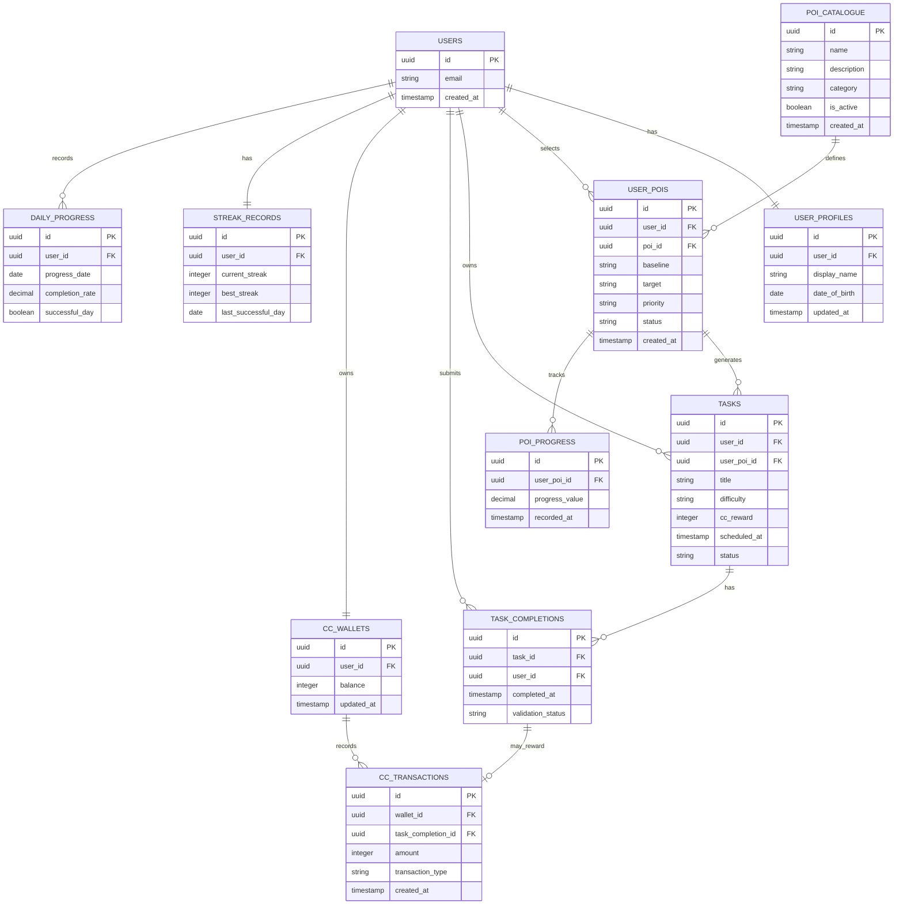

# Elixer™ — Entity Relationship Diagram (ERD)

## 1. Overview

This diagram describes the initial logical database structure of Elixer.

The database uses PostgreSQL.

Official POI definitions are managed by administrators, while users select POIs and maintain their own progress and goals.

## 2. Entity Relationship Diagram

## 3. Main Entity Descriptions

### User Management

- USERS: stores account-level user references.
- USER_PROFILES: stores additional profile information.

### POI Management

- POI_CATALOGUE: stores official POI definitions.
- USER_POIS: stores each user's selected POIs and personal configurations.

### Task Management

- TASKS: stores scheduled tasks.
- TASK_COMPLETIONS: stores submitted and validated completion records.

### Consistency Credits

- CC_WALLETS: stores the user's current CC balance.
- CC_TRANSACTIONS: maintains an auditable record of CC changes.

### Progress and Streaks

- STREAK_RECORDS: stores current and best streak information.
- DAILY_PROGRESS: stores daily completion and success results.
- POI_PROGRESS: stores historical progress measurements for individual POIs.

## 4. Important Database Rules

1. Each official POI is defined once in POI_CATALOGUE.
2. Users select official POIs through USER_POIS.
3. Users cannot modify official POI definitions.
4. Each task belongs to a user and can be associated with a selected POI.
5. Task completion records must be auditable.
6. CC transactions must be protected against duplicate rewards.
7. Wallet updates and corresponding transactions must be atomic.
8. Historical progress records should be preserved.
9. Sensitive domain data must be protected through appropriate authorization and database access policies.

## 5. Implementation Note

This is an initial logical ERD, not the final production database schema.

Individual POI domains will have their own specialized tables.

Additional entities, constraints, indexes, audit records and relationships will be added during database design.

