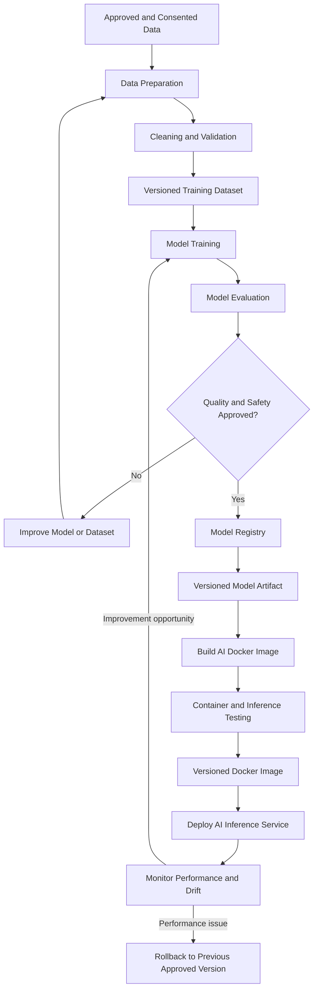

# AI Data, Training and Deployment Pipeline

This diagram illustrates Elixer's AI model development lifecycle, including data preparation, model training, evaluation, Docker packaging, model versioning and deployment.

