# Elixer™ — AI Data Training and Deployment Pipeline

## 1. Overview

Elixer maintains a controlled machine-learning pipeline for preparing datasets, training candidate models, evaluating their quality and deploying approved model versions.

The pipeline is separated from the production application backend.

Only approved model artifacts are made available to the inference environment.

## 2. AI Pipeline Diagram

```mermaid id="aipipe01"
flowchart TD

    SOURCE["Approved Data Sources"]

    subgraph GOVERNANCE["Data Governance"]
        CONSENT["Consent and Permission Checks"]
        MINIMIZE["Data Minimization and Pseudonymization"]
        APPROVAL["Dataset Usage Approval"]
    end

    subgraph PREPARATION["Data Preparation"]
        INGEST["Data Ingestion"]
        CLEAN["Data Cleaning and Validation"]
        FEATURES["Feature Engineering"]
        VERSION["Dataset Versioning"]
    end

    subgraph TRAINING["Model Development"]
        SPLIT["Training / Validation / Test Split"]
        BASELINE["Baseline Model"]
        TRAIN["Model Training"]
        TUNING["Model Tuning"]
    end

    subgraph EVALUATION["Model Evaluation"]
        METRICS["Performance Metrics"]
        GENERALIZATION["Generalization Testing"]
        SAFETY["Safety and Fairness Evaluation"]
        PRIVACY["Privacy and Security Review"]
        DECISION{"Meets Approval Criteria?"}
    end

    subgraph REGISTRY["Model Registry"]
        REGISTER["Register Model Artifact"]
        VERSIONMODEL["Model Version and Metadata"]
        APPROVED["Approved Model Version"]
    end

    subgraph DEPLOYMENT["Model Deployment"]
        PACKAGE["Package Model"]
        STAGING["Staging Deployment"]
        SMOKE["Integration and Smoke Tests"]
        PRODUCTION["Production Inference Deployment"]
    end

    subgraph MONITORING["Monitoring and Maintenance"]
        MONITOR["Monitor Quality, Drift and Latency"]
        ALERT["Detect Issues"]
        ROLLBACK["Rollback or Disable Model"]
        RETRAIN["Prepare a New Training Cycle"]
    end

    INFERENCE["AI Inference Environment"]

    SOURCE --> CONSENT
    CONSENT --> MINIMIZE
    MINIMIZE --> APPROVAL

    APPROVAL --> INGEST
    INGEST --> CLEAN
    CLEAN --> FEATURES
    FEATURES --> VERSION

    VERSION --> SPLIT
    SPLIT --> BASELINE
    BASELINE --> TRAIN
    TRAIN --> TUNING
    TUNING --> METRICS

    METRICS --> GENERALIZATION
    GENERALIZATION --> SAFETY
    SAFETY --> PRIVACY
    PRIVACY --> DECISION

    DECISION -->|No| TRAIN
    DECISION -->|Yes| REGISTER

    REGISTER --> VERSIONMODEL
    VERSIONMODEL --> APPROVED

    APPROVED --> PACKAGE
    PACKAGE --> STAGING
    STAGING --> SMOKE
    SMOKE --> PRODUCTION

    PRODUCTION --> INFERENCE
    INFERENCE --> MONITOR

    MONITOR --> ALERT
    ALERT --> ROLLBACK
    ROLLBACK --> RETRAIN
    RETRAIN --> CLEAN
```



## 3. Pipeline Stages

### Stage 1 — Data Governance

Before using data for model development:

- Verify the permitted purpose of data usage.
- Obtain required consent.
- Minimize collected information.
- Pseudonymize data where appropriate.
- Define retention and deletion policies.

### Stage 2 — Data Preparation

Prepare datasets using:

- Data ingestion.
- Data cleaning.
- Validation.
- Missing-value handling.
- Feature engineering.
- Dataset versioning.

### Stage 3 — Model Training

Develop a baseline model before training more complex candidates.

Training may involve:

- Feature selection.
- Model configuration.
- Hyperparameter tuning.
- Training and validation.
- Reproducible experiment tracking.

### Stage 4 — Evaluation

Evaluate candidate models for:

- Prediction quality.
- Generalization.
- Reliability.
- Fairness.
- Safety.
- Privacy.
- Security.

A candidate that fails evaluation must not be deployed.

### Stage 5 — Model Registry

Approved model artifacts should include:

- Model identifier.
- Model version.
- Dataset version.
- Training configuration.
- Evaluation results.
- Approval status.
- Creation timestamp.

### Stage 6 — Deployment

Deployment follows controlled stages:

1. Package the approved model.
2. Deploy to staging.
3. Run integration and smoke tests.
4. Deploy to production inference.
5. Verify model availability.

### Stage 7 — Monitoring

Monitor:

- Prediction quality.
- Data drift.
- Model latency.
- Error rates.
- Resource consumption.
- Safety issues.

When a serious issue is detected, the model can be disabled or rolled back.

## 4. Important Pipeline Rules

1. Only approved datasets may enter training.
2. Production data is not automatically training data.
3. Dataset versions must be traceable.
4. Training experiments should be reproducible.
5. Evaluation must happen before deployment.
6. Every deployed model must have a recorded version.
7. Model deployment must be controlled.
8. Model artifacts must be protected.
9. Rollback must be supported.
10. Training and inference environments must remain logically separated.
```
