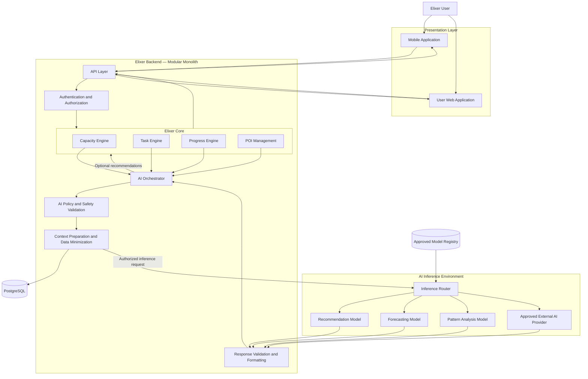

# Elixer™ — AI Inference and Orchestration Architecture

## 1. Overview

Elixer uses a dedicated AI Orchestrator inside its backend to coordinate AI-powered functionality.

The Orchestrator receives authorized requests from Core modules, prepares appropriate context, selects an available AI capability and communicates with the inference environment.

The inference environment returns predictions, analysis or recommendations.

AI does not directly modify authoritative application records.

## 2. AI Inference and Orchestration Diagram



## 3. AI Orchestrator Responsibilities

The AI Orchestrator acts as the integration layer between Elixer Core and AI capabilities.

Its responsibilities include:

- Receiving AI requests from Core modules.
- Selecting the appropriate AI capability.
- Preparing relevant contextual information.
- Enforcing data minimization and AI usage policies.
- Communicating with inference services.
- Validating AI responses.
- Returning structured results to Core.
- Handling inference failures and timeouts.

The Orchestrator does not own the business rules of individual POI domains.

## 4. Potential AI Capabilities

### Recommendation Model

Potential responsibilities:

- Suggesting relevant tasks.
- Recommending learning activities.
- Suggesting adjustments to personal goals.

### Forecasting Model

Potential responsibilities:

- Estimating progress trends.
- Forecasting potential goal completion.
- Identifying possible scheduling difficulties.

### Pattern Analysis Model

Potential responsibilities:

- Identifying activity patterns.
- Analyzing consistency trends.
- Identifying changes in progress patterns.

These are logical capabilities, not a commitment to train three separate custom models.

## 5. Inference Request Lifecycle

1. A Core module identifies a need for AI assistance.
2. The AI Orchestrator receives the request.
3. Authentication and authorization are enforced.
4. AI policy checks determine whether the request is permitted.
5. Only necessary and authorized contextual data is prepared.
6. The inference router selects an approved model or provider.
7. The model generates a response.
8. The response is validated and formatted.
9. The Orchestrator returns the result to Core.
10. Core decides whether and how to present or use the recommendation.

## 6. Important AI Security Rules

1. AI inference must happen through controlled backend services.
2. Mobile and browser applications must never receive private model-provider API keys.
3. Sensitive information must not be sent to external AI providers without appropriate authorization and consent.
4. AI responses must be validated before being used by the application.
5. AI cannot directly modify CC balances or streak records.
6. AI cannot directly execute financial transactions.
7. AI recommendations must remain optional and appropriately reversible.
8. Inference failures must not break essential application functionality.
9. Model versions and inference activity should be monitored.
10. Sensitive prompts and responses must follow data minimization and retention policies.
```
