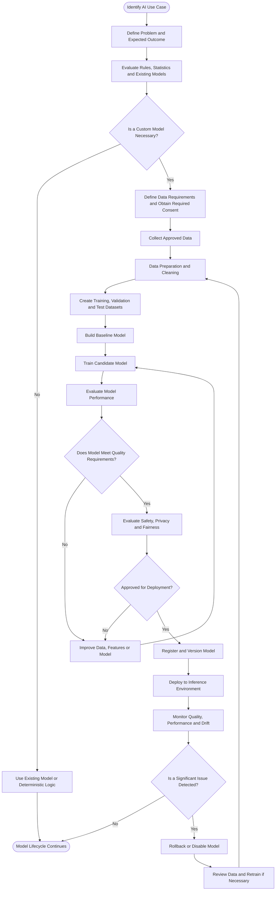

# Elixer™ — AI Model Development Lifecycle

## 1. Overview

Elixer uses a structured AI development lifecycle to build, evaluate, deploy and maintain AI-powered capabilities.

AI development is maintained separately from the main application backend.

Models must meet defined quality, privacy, safety and performance requirements before deployment.

## 2. AI Model Development Lifecycle Diagram

## 3. Lifecycle Stages

### Stage 1 — Problem Definition

Identify the problem an AI capability should solve.

Potential Elixer use cases:

- Personalized task recommendations.
- Capacity estimation assistance.
- Progress pattern analysis.
- Goal forecasting.
- Personalized learning recommendations.

### Stage 2 — Feasibility Assessment

Before training a model, evaluate whether the problem can be solved using:

- Deterministic business rules.
- Statistical methods.
- Existing pretrained models.
- Custom machine learning models.

Custom training should only happen when justified.

### Stage 3 — Data Preparation

Prepare approved datasets.

Activities include:

- Data validation.
- Data cleaning.
- Missing-value handling.
- Feature engineering.
- Pseudonymization where appropriate.
- Dataset versioning.

Training datasets must be separated from production data.

### Stage 4 — Model Training

Develop a baseline and train candidate models.

Potential tools include:

- Python.
- Pandas and NumPy.
- Scikit-learn.
- PyTorch.

### Stage 5 — Model Evaluation

Evaluate:

- Prediction quality.
- Reliability.
- Generalization.
- Fairness.
- Safety.
- Privacy.
- Performance.

A model must not be deployed merely because its training accuracy is high.

### Stage 6 — Registration and Deployment

Approved models receive:

- Model version.
- Configuration.
- Evaluation results.
- Deployment record.

Models are deployed to a controlled inference environment.

### Stage 7 — Monitoring

Monitor:

- Model performance.
- Prediction quality.
- Data drift.
- Latency.
- Failure rates.
- Safety issues.

Models can be disabled or rolled back when necessary.

## 4. Important AI Governance Rules

1. Use only approved and appropriately consented training data.
2. Minimize sensitive personal information.
3. Keep production data separate from curated training datasets.
4. Evaluate safety and fairness before deployment.
5. Version datasets, models and evaluation results.
6. Monitor deployed models continuously.
7. Support rollback to a previously approved model.
8. AI must not diagnose mental health conditions or judge user worth.
9. AI must not directly control CC balances, streaks or authoritative financial records.
10. AI recommendations should remain optional and subject to appropriate user controls.
