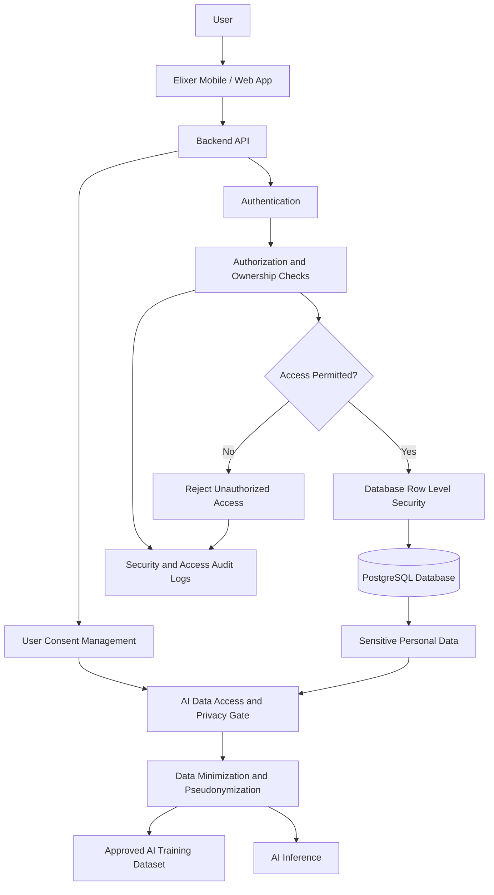

# Data Privacy and Access Control

This diagram illustrates how Elixer protects user data through authentication, authorization, data access policies, consent management and controlled AI data processing.

