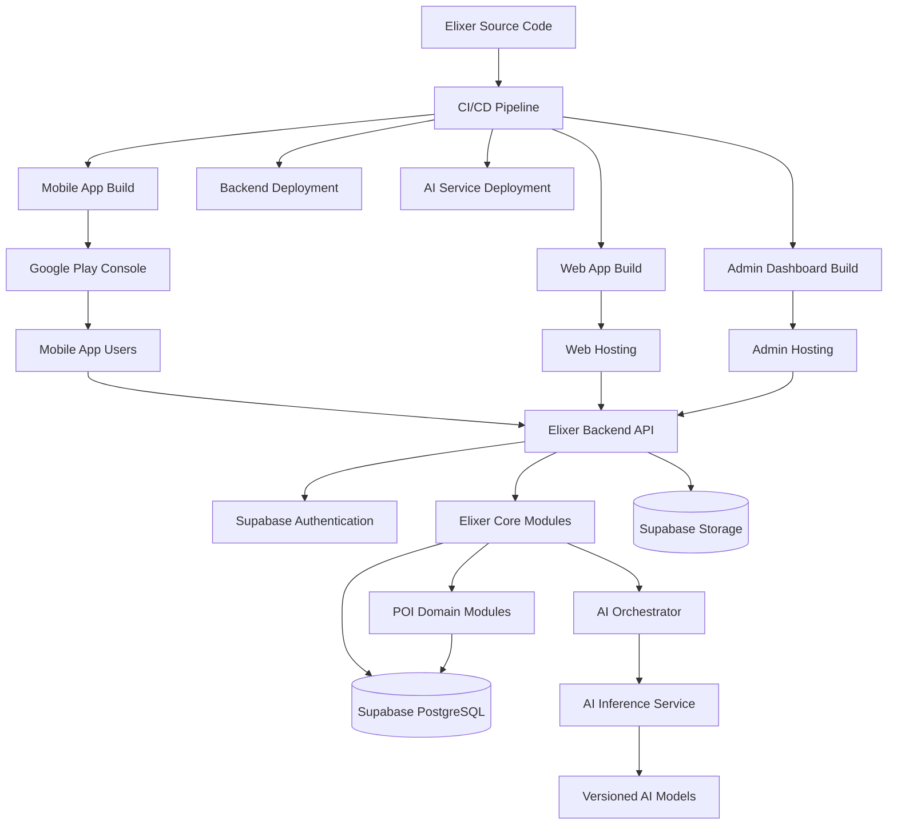

# Elixer Deployment Architecture

This diagram illustrates the proposed production deployment architecture for Elixer, including client applications, backend services, database infrastructure, storage and AI services.

